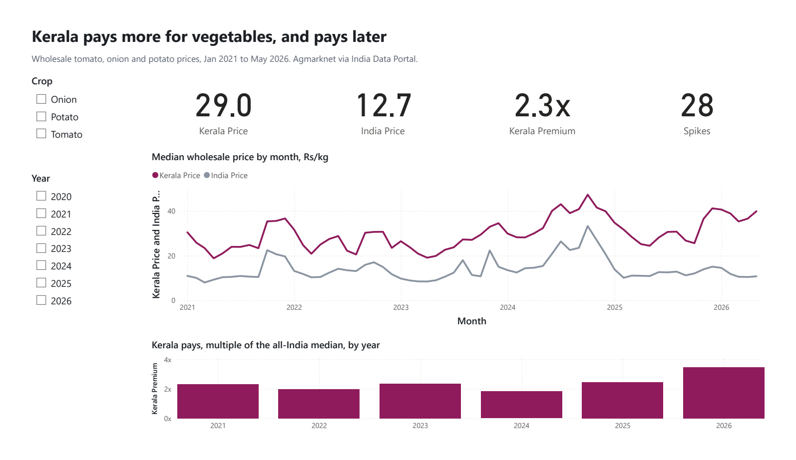
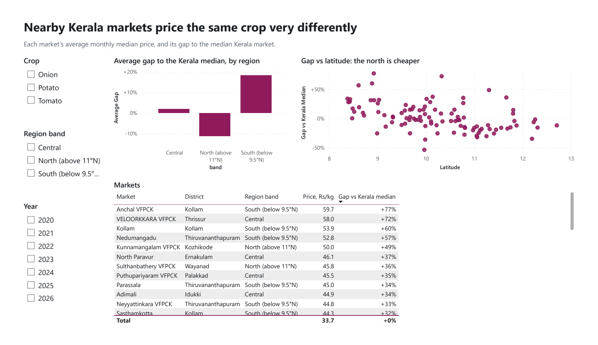
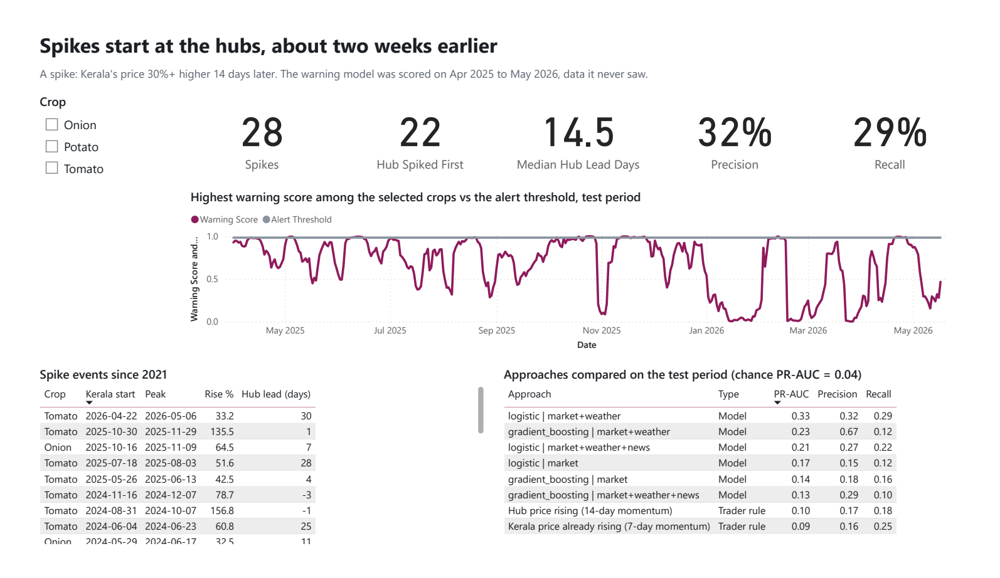
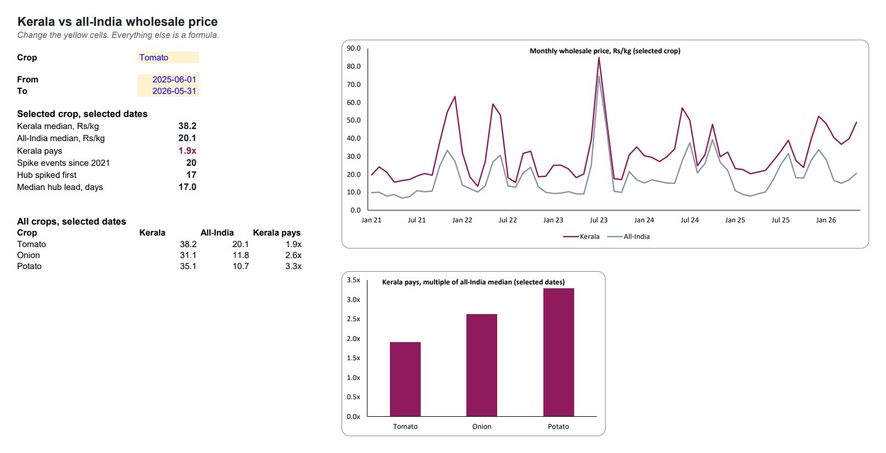

# Kerala vegetable prices: shocks, gaps and a 16-day warning

Kerala buys most of its tomato, onion and potato from markets in Karnataka, Maharashtra, Tamil Nadu and
Uttar Pradesh. This project uses 26.5 million wholesale market records (2021 to May 2026) to answer three
questions a buyer, cooperative or planner in Kerala actually asks:

1. **How much more does Kerala pay, and how fast do shocks arrive?**
2. **How far apart do nearby Kerala markets price the same crop on the same day?**
3. **Can a spike be seen coming?** A model that warns when Kerala's price will be 30% higher in 14 days.

**Live case study:** https://kerala-veg-prices.vercel.app

## Findings

| | |
|---|---|
| Kerala vs all-India wholesale, Jun 2025 to May 2026 | tomato 1.9x, onion 2.6x, potato 3.3x (Rs 38.2 vs 20.1, 31.0 vs 11.8, 35.1 vs 10.7 per kg) |
| Same-day gap between Kerala markets within 40 km | tomato median 20%, and 20% or more on half of all pair-days |
| North vs south Kerala | tomato markets above 11°N sit 26% below the Kerala median; Spearman −0.69 with latitude |
| Shock transmission, hub to Kerala | same-week correlation 0.57 (tomato), 0.47 (onion); 74%/63% of a rise/fall passed on for tomato; asymmetry not significant |
| Spike events since 2021 | 28; the hub spiked first in 22, a median 14.5 days earlier |
| Spike warning, held-out test (Apr 2025 to May 2026) | PR-AUC 0.33 vs 0.04 chance and 0.09–0.10 for trader rules; 4 of 5 spikes warned, median 16 days before the peak |
| Scraped news volume as a feature | made the model worse (PR-AUC 0.21); left out |

## Power BI and Excel

The same tables, rebuilt for the tools analysts use day to day:

- **Power BI report** ([`powerbi/KeralaVegPrices.pbix`](powerbi/KeralaVegPrices.pbix), or the text-based project
  [`powerbi/KeralaVegPrices.pbip`](powerbi/KeralaVegPrices.pbip); [PDF](reports/kerala_veg_prices_powerbi.pdf)).
  Three pages: Overview, Markets, Shocks & warning. A star schema with a DAX date and crop table, seven facts and
  dimensions loaded through Power Query, and measures such as `Kerala Premium = DIVIDE([Kerala Price], [India Price])`
  and the warning model's precision and recall. The project is generated by `powerbi/build_pbip.py` (TMDL + PBIR).
- **Excel workbook** ([`reports/kerala_veg_prices.xlsx`](reports/kerala_veg_prices.xlsx)). A dashboard with a crop
  picker that drives the KPIs and a line chart, a year-by-crop premium heatmap, a market sheet with gap formulas, a
  PivotTable with slicers, and a Checks sheet where 12 headline numbers are recomputed with Excel formulas
  (`AGGREGATE` as a conditional median, `COUNTIFS`, `XLOOKUP`) and matched to Python. Built by `pipeline/60_excel.py`.






## Data and scraping

| Source | Use | How |
|---|---|---|
| [India Data Portal (ISB), Agriculture Marketing](https://ckandev.indiadataportal.com/dataset/agriculture-marketing), ODC-By | 26,504,208 Agmarknet records | `00_download.py`: parallel, resumable range download |
| [Open-Meteo archive](https://open-meteo.com/) | daily rain and max temperature at each origin hub | `12_weather.py` with [Scrapling](https://github.com/D4Vinci/Scrapling) |
| [GDELT DOC 2.0 API](https://blog.gdeltproject.org/gdelt-doc-2-0-api-debuts/) | daily news volume per crop, article titles around spikes | `10_scrape_news.py` with Scrapling, 1 request per 5 s |

What was deliberately **not** scraped:
- **Agmarknet's own site and the Consumer Affairs price portal** are CAPTCHA-gated, so I used the portal copy of the same data instead.
- **Google News RSS and The Hindu BusinessLine** disallow AI crawlers in their `robots.txt`.

A PIB press-release scraper (`11_scrape_pib.py`) is included, but its GDELT-based discovery found no releases, so it contributes nothing. Every fetch sends an honest User-Agent, with no fake browser headers.

## Pipeline

```
00_download → 01_ingest (typed Parquet, manifest) → 02_build (sql/01_clean.sql, 20_hubs) → 03_tests (13 checks)
  → 21_transmission · 22_dispersion · 23_spikes → 30_model → 50_export (Flourish CSVs)
  → 55_bi_export (star schema CSVs) → 60_excel (workbook) ; powerbi/build_pbip.py (Power BI project)
```

Cleaning decisions (all in `sql/01_clean.sql`):
- **Market identity.** Markets are identified by state plus normalised name. The two sources use different market codes, and the old source carries two code systems that overlap from 2021 to 2023: 3,860 codes resolve to 2,007 markets. One record is kept per market, day, crop, variety and grade.
- **Outlier filter.** A market-day more than 3× off its state's median for that day is dropped. That's under 2% in Kerala, and it removes, for example, a market reporting a flat ₹270/kg for weeks.
- **Model evaluation.** Chronological train/validation/test split with a 14-day purge gap. The model and threshold are chosen on validation, and the test is reported once.

```bash
pip install duckdb pyarrow pandas scikit-learn statsmodels scipy "scrapling[fetchers]" requests openpyxl
pip install pywin32   # optional, Windows with Excel: adds the PivotTable and checks the formulas in Excel
python pipeline/00_download.py
python run_all.py
python -m http.server 8000 --directory site
```

## Limits

- **Wholesale, not retail.** These are wholesale prices, not shop prices.
- **The premium isn't a margin.** It includes transport, handling and losses as well as margins.
- **Small test sample.** The test period holds five spikes.
- **Correlation, not causation.** Price co-movement doesn't establish where a shock started.

## Literature

See [`docs/literature.md`](docs/literature.md) for 13 papers on Indian TOP price volatility, transmission and ML forecasting, and how this project compares.
